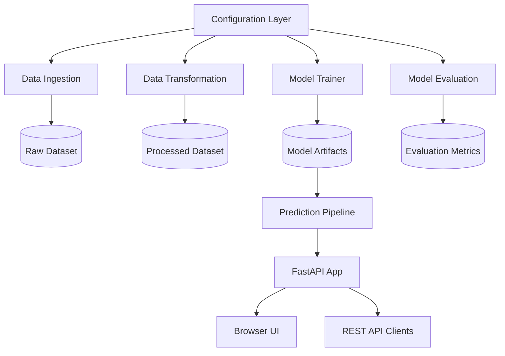

# ✨ TextSummarizer: Production-Grade NLP & MLOps Summarization Platform

[](https://www.python.org/)
[](https://fastapi.tiangolo.com/)
[](https://huggingface.co/google/pegasus-cnn_dailymail)
[](https://www.docker.com/)
[](LICENSE)

An end-to-end NLP and MLOps project for automated text summarization. This repository demonstrates production-style development practices: modular pipeline architecture, model training and evaluation, inference serving through FastAPI, and a lightweight browser-based UI for end-user interaction.

The goal is to transform long-form text into concise, useful summaries using a transformer-based model while keeping the codebase clean, scalable, and deployable in modern cloud environments.

---

## 📑 Table of Contents

- [System Architecture](#-system-architecture)
- [ML Pipeline Workflow](#-ml-pipeline-workflow)
- [Project Directory Structure](#-project-directory-structure)
- [Tech Stack](#-tech-stack)
- [Getting Started](#-getting-started)
  - [Prerequisites](#prerequisites)
  - [Installation](#installation)
- [Usage & Execution](#-usage--execution)
  - [1. Running the ML Pipeline (CLI)](#1-running-the-ml-pipeline-cli)
  - [2. Launching the Web Application](#2-launching-the-web-application)
- [API Endpoints](#-api-endpoints)
- [Deploy on Render](#-deploy-on-render)
- [CI/CD](#-cicd)
- [Software Engineering Standards](#-software-engineering-standards)
- [Author & License](#-author--license)

---

## 🏛 System Architecture

The project follows a modular and configuration-driven architecture where each stage of the ML lifecycle is isolated and reusable.



This design keeps configuration, training, inference, and deployment concerns separate while making it easier to update and scale the system.

---

## 🔄 ML Pipeline Workflow

Each stage follows a practical MLOps flow:

1. Update configuration values in `config/config.yaml`
2. Update training parameters in `params.yaml`
3. Run data ingestion and build preparation
4. Transform the dataset for model input
5. Train the summarization model
6. Evaluate the model with metrics
7. Serve the trained model through an API/UI

| Stage | Name | Description | Output |
| :--- | :--- | :--- | :--- |
| 01 | Data Ingestion | Downloads and prepares the summarization dataset | `artifacts/data_ingestion/` |
| 02 | Data Transformation | Tokenizes and transforms text data for fine-tuning | `artifacts/data_transformation/` |
| 03 | Model Training | Trains a PEGASUS-based summarization model | `artifacts/model_trainer/` |
| 04 | Model Evaluation | Measures model quality with validation metrics | `artifacts/model_evaluation/` |
| 05 | Model Inference | Serves the trained model through FastAPI | browser + API output |

---

## 📁 Project Directory Structure

```text
NLP_End_to_End_Project/
├── app.py                                 # FastAPI app and routes
├── Dockerfile                             # Docker deployment config
├── main.py                                # Pipeline execution entry point
├── params.yaml                            # Training parameters
├── requirements.txt                       # Python dependencies
├── setup.py                               # Package config
├── README.md                              # Project documentation
├── render.yaml                            # Render deployment config
├── workflow.md                            # Workflow notes
├── config/
│   └── config.yaml                        # Project config and paths
├── artifacts/
│   ├── data_ingestion/
│   ├── data_transformation/
│   ├── model_evaluation/
│   └── model_trainer/
├── logs/
│   └── running_logs.log                   # Logger output
├── research/
│   ├── data_ingestion.ipynb
│   ├── data_transformation.ipynb
│   ├── model_training.ipynb
│   ├── model_evaluation.ipynb
│   └── research.ipynb
├── src/
│   └── textSummarizer/
│       ├── __init__.py
│       ├── components/
│       │   ├── data_ingestion.py
│       │   ├── data_transformation.py
│       │   ├── model_trainer.py
│       │   └── model_evaluation.py
│       ├── config/
│       │   └── configuration.py
│       ├── constants/
│       │   └── __init__.py
│       ├── entity/
│       │   └── __init__.py
│       ├── logging/
│       │   └── __init__.py
│       ├── pipeline/
│       │   ├── data_transformation_pipeline.py
│       │   ├── model_evaluation_pipeline.py
│       │   ├── model_trainer_pipeline.py
│       │   ├── prediction_pipeline.py
│       │   └── stage_data_ingestion_pipeline.py
│       └── utils/
│           └── common.py
├── templates/
│   └── index.html                         # Web UI for summarization
├── .github/
│   └── workflows/
│       └── ci-cd.yml                     # GitHub Actions pipeline
└── research/
```

---

## 🛠 Tech Stack

- **Language**: Python 3.10+
- **Deep Learning**: PyTorch, Hugging Face Transformers
- **NLP Model**: PEGASUS summarization model
- **API**: FastAPI, Uvicorn
- **Data Processing**: Pandas, NumPy, Datasets
- **Config & Utilities**: PyYAML, Python `pathlib`
- **Frontend**: HTML, CSS, JavaScript
- **Deployment**: Docker, Render
- **Automation**: GitHub Actions

---

## 🚀 Getting Started

### Prerequisites

- Python 3.10 or higher installed
- `pip` or `conda` available
- Git installed
- Access to the internet for downloading model/data files

### Installation

1. Clone the repository

```bash
git clone https://github.com/<your-username>/NLP_End_to_End_Project.git
cd NLP_End_to_End_Project
```

2. Create and activate a virtual environment

```bash
python -m venv venv
source venv/bin/activate
```

3. Install dependencies

```bash
pip install -r requirements.txt
```

4. Verify the app runs

```bash
python -m uvicorn app:app --host 0.0.0.0 --port 8000 --reload
```

---

## 💻 Usage & Execution

### 1. Running the ML Pipeline (CLI)

To run the full training pipeline from ingestion to evaluation:

```bash
python main.py
```

This executes the major project stages and saves artifacts under the `artifacts/` directory.

### 2. Launching the Web Application

To start the prediction service and UI:

```bash
python -m uvicorn app:app --host 0.0.0.0 --port 8000 --reload
```

Then open:

- API docs: `http://127.0.0.1:8000/docs`
- Browser UI: `http://127.0.0.1:8000/ui`

---

## 🌐 API Endpoints

| HTTP Method | Route | Description |
| :--- | :--- | :--- |
| `GET` | `/` | Root route / app landing info |
| `GET` | `/ui` | Renders the text summarization web interface |
| `GET` | `/train` | Starts the model training pipeline |
| `POST` | `/predict` | Accepts text input and returns a summary |

### Request payload for `/predict`

```json
{
  "text": "Long input text that needs to be summarized."
}
```

### Example request

```bash
curl -X POST "http://127.0.0.1:8000/predict" \
  -H "Content-Type: application/json" \
  -d '{"text":"Artificial intelligence systems are transforming the way organizations work, process information, and create value. Summaries allow users to capture key meaning quickly without reading long documents in full."}'
```

### Example response

```json
{
  "summary": "AI systems are changing how organizations work and create value, and summaries help users quickly understand the main idea without reading long documents."
}
```

---

## 🌐 Deploy on Render

This project is deployment-ready for Render using Docker. also can deploy on the Dockerhub 

### Render deployment steps

1. Push the repository to GitHub.
2. Open the Render dashboard.
3. Select **New** → **Web Service**.
4. Connect the repository.
5. Choose **Docker** as the runtime.
6. Render will read the Dockerfile automatically and deploy the app.

### Render configuration

A sample `render.yaml` file is included to make deployment easier.

### Required runtime settings

- Service type: `Web Service`
- Runtime: `Docker`
- Port: `8000`
- Start command: handled by Docker

---

## 🔄 CI/CD

The repository includes a GitHub Actions workflow in `.github/workflows/ci-cd.yml` that validates:

- dependency installation
- app import and smoke testing
- Docker build health

This helps ensure the project remains stable before deployment.

---

## 🛡 Software Engineering Standards

- **Modular architecture** for stages such as ingestion, transformation, model training, and evaluation
- **Configuration-driven setup** via YAML files
- **Reusable pipeline design** for easier experimentation
- **FastAPI inference layer** for clean API-based serving
- **Container-ready deployment** for cloud hosting
- **Structured logging** to improve debugging and monitoring

---

## 📜 Author & License

Developed by **Sheshpal Singh**

- GitHub: [@sheshpalsingh01](https://github.com/sheshpalsingh01)
- Portfolio / profile: [GitHub profile](https://github.com/sheshpalsingh01)


---

If you want to extend the project further, the next best upgrades would be:

- model versioning and experiment tracking
- batch inference support
- user authentication in the UI
- improved prompt tuning and evaluation
- production monitoring and logging with external dashboards
